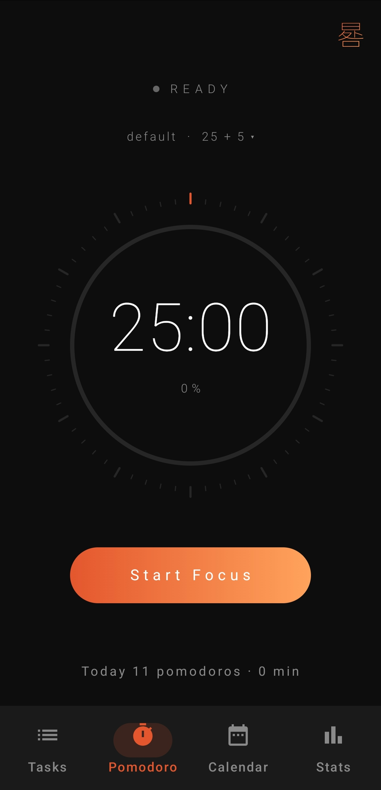
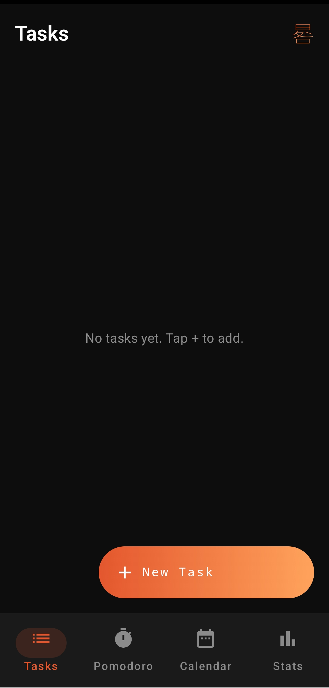
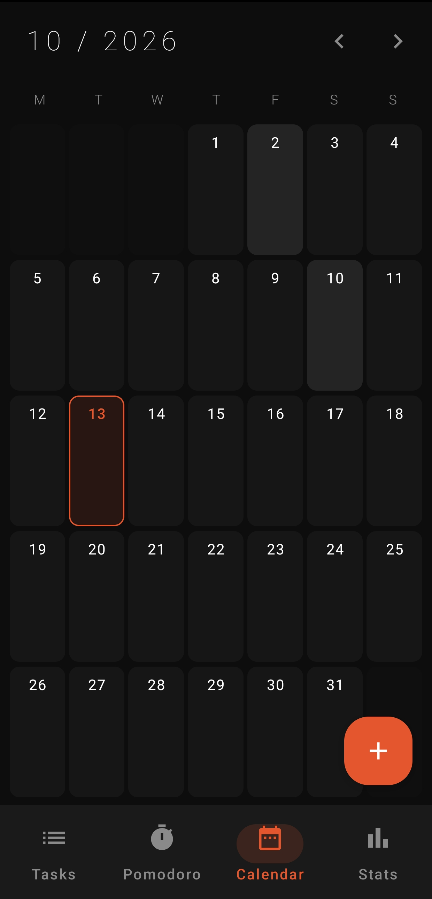
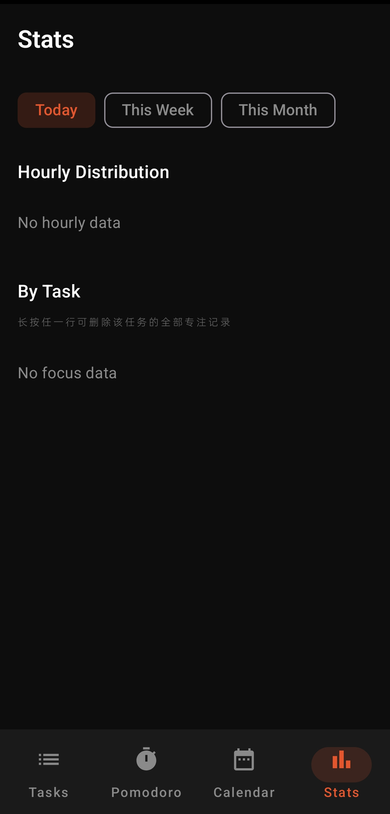

# 晷 · Gui

**以晷量时，以行成事**
*Measure time, achieve deeds*

一个专注、克制、有仪式感的番茄钟 App

[下载最新版](https://github.com/yipj1202-oss/gui/releases/latest) · [反馈问题](https://github.com/yipj1202-oss/gui/issues)

---

| 主页 | 任务 | 日历 | 统计 |
| :---: | :---: | :---: | :---: |
|  |  |  |  |

---

## ✦ 关于

「晷」取自「日晷」——古时用日影计时的仪器。
App 想做的，是把"时间"这件事，重新变得**有重量**。

没有花哨的动画，没有廉价的成就感。
只有一圈刻度、一道影子、一次专注。

---

## ✦ 功能

- **番茄钟** — 开始 / 暂停 / 继续 / 跳过 / 结束，前台服务实时刷新通知栏
- **任务管理** — 增删改查、勾选完成、图片多选（最多 5 张）、从详情页直接开始番茄
- **日历视图** — 月视图、格子显示任务名、左右滑动切月、点击年份选年、任务名跑马灯
- **数据统计** — 磁吸游标 + 折线趋势 + 按任务横向条形图、长按任务行可删除该任务的全部专注记录
- **自定义方案** — 旋钮拖动调时长，可点击数字键盘直输、可设为默认 / 狂暴方案
- **OVERCLOCK** — 连点右上角「晷」3 次触发狂暴模式，切换独立自定义方案，完成一周期自动退出
- **音效** — AudioTrack 合成三套提示音（暮鼓 / 松风 / 涧泉），支持光波预览
- **主题** — 深色 / 浅色，全局跟随
- **语言** — 中文 / English
- **备份** — 一键导出 / 导入 `.guiback` 备份文件
- **小组件** — 桌面 Widget 快速查看番茄状态

---

## ✦ 设计语言

- **主色** — `#E4572E` → `#FFA35C`（橙渐变）
- **背景** — `#0D0D0D`（深黑）/ `#F5F1EA`（米白）
- **卡片** — `#141414` / `#1A1A1A`，靠 1px 极细描边区分，无阴影
- **字体** — Thin / Light 为主，宽字距，仪表盘风格
- **动效** — 一切要有"重量"：按压回弹、拖拽让位、液体指示器、错落入场

---

## ✦ 技术栈

| 分类 | 技术 |
| --- | --- |
| 语言 | Kotlin 1.9.24 |
| UI | Jetpack Compose + Material3 (BOM 2024.09.00) |
| 数据库 | Room 2.6.1 |
| 导航 | Navigation Compose 2.7.7 |
| 图片 | Coil 2.7.0 |
| 架构 | MVVM · 单 Activity · 前台服务驱动计时 |

---

## ✦ 构建

要求：Android Studio Hedgehog 或更新版本、JDK 17

    git clone https://github.com/yipj1202-oss/gui.git
    cd gui
    ./gradlew assembleDebug

APK 输出：`app/build/outputs/apk/debug/app-debug.apk`

---

## ✦ 更新日志

见 [CHANGELOG.md](CHANGELOG.md)

---

## ✦ 许可证

本项目采用 **GNU General Public License v3.0** 授权。

这意味着你可以：

- ✅ 自由使用、修改、分发
- ✅ 商业使用

但必须：

- 📖 公开源代码
- 📖 修改后的作品同样采用 GPL-3.0 授权
- 📖 保留原作者版权声明

详见 [LICENSE](LICENSE)

---

**GPL-3.0 · Made with 🍅 by [yipj1202-oss](https://github.com/yipj1202-oss)**

---

---

# English

**Gui** — *Measure time, achieve deeds*

A focused, restrained Pomodoro timer with a sense of ceremony.

## About

**Gui (晷)** takes its name from the ancient Chinese sundial — a tool that measured time by the shadow of the sun.

This app tries to give "time" back its **weight**.
No flashy animations. No cheap sense of accomplishment.
Just a ring of tick marks, a shadow, and one moment of focus.

## Features

- **Pomodoro** — start / pause / resume / skip / finish, foreground service with live notification
- **Tasks** — CRUD, mark complete, multi-image (up to 5), start Pomodoro from task detail
- **Calendar** — month view, swipe to change months, tap year to pick, marquee for long titles
- **Stats** — magnetic cursor + trend line + per-task bar chart; long-press a task row to clear its focus records
- **Custom presets** — rotary knobs for durations, tap the number to type directly, set as default / overclock preset
- **OVERCLOCK** — tap the top-right "晷" 3 times to trigger boost mode with a dedicated preset
- **Sound** — 3 synthesized alert tones (Dusk Drum / Pine Wind / Mountain Spring) with wave preview
- **Theme** — dark / light
- **Language** — 中文 / English
- **Backup** — export / import `.guiback` files
- **Widget** — home-screen widget for current status

## Design Language

- **Primary** — `#E4572E` → `#FFA35C` (orange gradient)
- **Background** — `#0D0D0D` (dark) / `#F5F1EA` (light)
- **Cards** — `#141414` / `#1A1A1A`, separated by 1px hairline strokes, no shadows
- **Typography** — Thin / Light weights, wide letter-spacing, dashboard style
- **Motion** — everything should feel *weighty*: spring-back on press, drag displacement, liquid indicators, staggered entrances

## Tech Stack

Kotlin · Jetpack Compose · Material3 · Room · Navigation Compose · Coil

## Build

    git clone https://github.com/yipj1202-oss/gui.git
    cd gui
    ./gradlew assembleDebug

## License

**GNU General Public License v3.0** — see [LICENSE](LICENSE)

You are free to use, modify, and distribute this software, but any derivative work must also be released under GPL-3.0 with source code publicly available.

---

**GPL-3.0 · Made with 🍅 by [yipj1202-oss](https://github.com/yipj1202-oss)**

